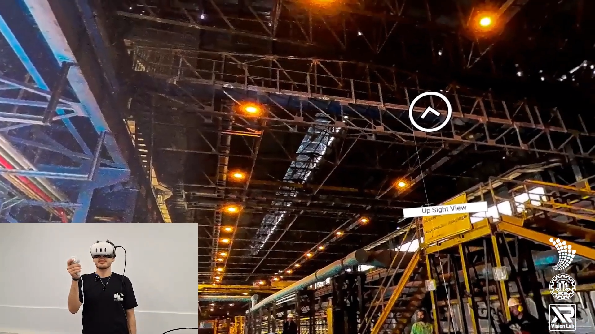
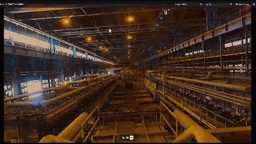
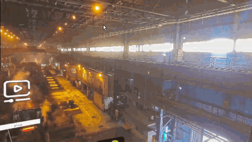
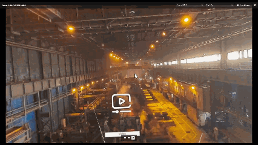

# کامپیوتور | Computour

### **حل مشکل سختی بازدید از کارخانه‌ها، صنایع و شرکت‌ها با استفاده از تورهای مجازی**

**کامپیوتور** یک راهکار کاملا بومی‌سازی‌شده برای ساخت تورهای مجازی از کارخانه‌ها، محیط‌های صنعتی، شرکت‌ها و محیط‌های پرخطر است؛ راهکاری که به سازمان‌ها کمک می‌کند بدون نیاز به حضور فیزیکی افراد، محیط خود را در هر زمان و از هر نقطه در اختیار مخاطبان قرار دهند.

---

## [ معرفی کامپیوتور را در عمل ببینید ](https://docs.google.com/videos/d/1hnYPsRzEaVgOWaO4bnE4pu10_EMyIL_uk21Z1nRqnIU/play?usp=sharing)

## نمایی از محصول

---

## کامپیوتور چیست؟

بازدید از کارخانه‌ها، محیط‌های صنعتی و به‌خصوص محیط‌های پرخطر، همیشه ساده و کم‌هزینه نیست.

**کامپیوتور** با ساخت تور مجازی از محیط‌های واقعی، این امکان را فراهم می‌کند که افراد بتوانند بدون حضور فیزیکی، یک محیط صنعتی یا سازمانی را به‌صورت تعاملی تجربه و بررسی کنند.

این تورهای مجازی می‌توانند به دو شکل ارائه شوند:

* **بر روی عینک‌های واقعیت مجازی** برای ایجاد یک تجربه immersive
* **بر روی وب‌سایت** برای دسترسی آسان از هر مکان و بدون نیاز به تجهیزات تخصصی

به این ترتیب به جای اینکه همیشه افراد را به محیط موردنظر ببریم، می‌توانیم **محیط را به افراد ارائه کنیم.**

---

## چه مشکلی را حل می‌کند؟

بازدید فیزیکی از کارخانه‌ها و محیط‌های صنعتی معمولا با چالش‌های مختلفی همراه است:

*  وجود خطرات و محدودیت‌های ایمنی
*  هزینه‌های رفت‌وآمد و حضور بازدیدکنندگان
*  نیاز به افراد آموزش‌دیده برای توضیح محیط در هر بازدید
*  احتمال نیاز به توقف یا اختلال در خط تولید
*  نیاز به فراهم کردن شرایط ایمنی برای بازدیدکنندگان
*  عدم امکان بازدید آسان برای افرادی که در شهر یا کشور دیگری حضور دارند
*  محدود بودن زمان و شرایط انجام بازدیدهای حضوری

در بسیاری از موارد، حتی برگزاری یک بازدید ساده نیازمند هماهنگی، هزینه و آماده‌سازی قابل توجهی است.

### کامپیوتور این مدل را تغییر می‌دهد.

به جای اینکه برای هر بازدید، افراد را به کارخانه یا محیط صنعتی بیاوریم، می‌توانیم **یک نسخه مجازی از آن محیط را در اختیار آنها قرار دهیم.**

---

## چرا کامپیوتور؟

کامپیوتور صرفاً یک تصویر ۳۶۰ درجه از یک محیط نیست.

هدف، ساخت یک **تجربه مجازی تعاملی و قابل شخصی‌سازی** است که بتوان آن را بر اساس نوع سازمان، مخاطب و هدف بازدید تغییر داد.

### بومی‌سازی کامل

کامپیوتور با هدف پاسخگویی به نیازهای واقعی سازمان‌ها و محیط‌های مختلف طراحی شده است.

ساختار تور مجازی می‌تواند متناسب با محیط، هویت، نیازها و اهداف هر مجموعه تغییر کند.

### شخصی‌سازی کامل

هر سازمان محیط، مخاطب و هدف متفاوتی دارد.

به همین دلیل، کامپیوتور به گونه‌ای طراحی شده که بخش‌های مختلف تجربه، از نحوه نمایش محیط و منوها گرفته تا مسیر حرکت و سناریوها، قابل شخصی‌سازی باشند.

### نگهداری اطلاعات به‌صورت Local

برای شرکت‌ها و سازمان‌هایی که نسبت به اطلاعات محیط و مجموعه خود حساس هستند، امکان قرارگیری اطلاعات موردنیاز به‌صورت **کاملا لوکال در پروژه** وجود دارد.

این ویژگی امکان کنترل بیشتر بر اطلاعات و کاهش وابستگی به سرویس‌های خارجی را فراهم می‌کند.

### سناریوهای متفاوت

یک محیط مجازی لزوما نباید برای همه افراد یک تجربه یکسان داشته باشد.

می‌توان برای مخاطبان و اهداف مختلف، سناریوهای متفاوت تعریف کرد؛ برای مثال:

* بازدید آموزشی
* آموزش نیروها
* معرفی کارخانه به مهمانان
* ارائه به مشتریان یا شرکای تجاری
* بازدیدهای تخصصی
* معرفی بخش‌های مختلف یک مجموعه

### خروجی بر روی عینک واقعیت مجازی

امکان پیاده‌سازی بر روی عینک واقعیت مجازی Meta Quest

---

## نمایی از محصول

### محیط اصلی

---

### مسیریابی و منو

---

### تجربه تور مجازی

---

## ارتباط با ما

### اگر به کامپیوتور علاقه‌مند هستید یا به دنبال فرصت همکاری هستید:

### با ما در ارتباط باشید: **[shamsi84sh@gmail.com](mailto:shamsi84sh@gmail.com)** 
